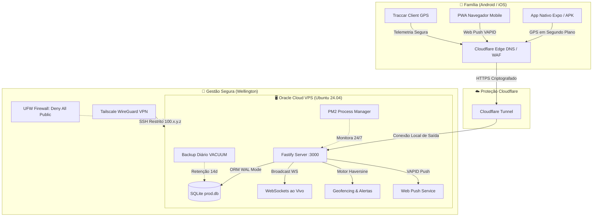

# 🛰️ My Life360 — Rastreador Familiar Privado & Independente

> [!abstract] Resumo Executivo
> O **My Life360** é uma plataforma completa e autônoma de localização familiar em tempo real, criada para substituir integralmente o aplicativo comercial **Life360**. Hospedada em VPS própria (Oracle Cloud) e rodando 24/7, ela elimina assinaturas abusivas (Gold/Platinum), garante **privacidade absoluta** (sem venda de telemetria da família para corretores de dados) e desbloqueia **histórico e lugares ilimitados**.

---

## 🧭 1. Por Que Este Projeto Existe? (O Manifesto)

O Life360 oficial tornou-se inviável por três razões fundamentais:
1. **Privacidade Comprometida:** Modelos comerciais de apps de rastreamento monetizam a venda do histórico de localização dos usuários para anunciantes e seguradoras.
2. **Paywalls Agressivos:** Histórico acima de 2 dias, mais de 2 lugares cadastrados e relatórios detalhados de velocidade exigem planos de R$ 30 a R$ 60/mês.
3. **Risco de Bloqueios:** Depender de APIs proprietárias deixa a família vulnerável a mudanças repentinas de termos e cancelamentos.

> [!success] Solução Conquistada
> - **100% Nosso:** Código aberto, auditável e sob nosso total controle.
> - **Histórico Infinito:** Todo o histórico de trajetos, velocidades e paradas guardado no SQLite com alta performance.
> - **Custo Zero Recorrente:** Hospedado no tier gratuito vitalício da Oracle Cloud com Cloudflare Tunnel.

---

## 🏗️ 2. Arquitetura do Sistema & Segurança

A segurança foi desenhada com foco em **Defesa em Profundidade**, garantindo que a VPS não fique exposta a invasões ou varreduras de portas.



### Pilares de Blindagem da VPS:
- **Zero Portas Abertas na Internet:** O `cloudflared` cria uma conexão de *saída* para a Cloudflare. Nenhuma porta (nem 80, nem 443, nem 3000) escuta na internet pública.
- **SSH Exclusivo via Tailscale:** O SSH só aceita conexões autenticadas pela interface privada Mesh WireGuard (`tailscale0`).
- **Autenticação de Telemetria:** Cada celular possui uma chave exclusiva (`l360_...`) validada com `timingSafeEqual` (proteção contra ataques de temporização).
- **Backups Blindados:** Backup diário automático via `VACUUM INTO` (sem corromper banco em escrita) com rotação de 14 dias em pasta restrita.

---

## 🧩 3. Módulos Implementados (A Linha do Tempo)

O desenvolvimento foi estruturado em 9 blocos modulares sólidos:

### 📦 Bloco 1: Contrato de Dados & Banco Relacional
- **SQLite 3 em Modo WAL (`Write-Ahead Logging`):** Altíssima velocidade para escritas contínuas de GPS concorrentes sem travar leituras.
- **Prisma ORM:** Schemas tipados para `User`, `Device`, `Location`, `Place`, `PlaceEvent`, `Trip`, `ChatMessage`, `DirectMessage`, `SosEvent`, `Circle`, `CircleMember` e `AccessLog`.

### ⚡ Bloco 2: Servidor API & WebSockets em Tempo Real
- **Fastify (Node.js/TypeScript):** Performance superior ao Express, com validação de schemas.
- **WebSockets Bidirecionais:** Transmissão instantânea de novas posições, mensagens de chat e disparos de emergência.

### 📍 Bloco 3: Motor de Geofencing & Cercas Virtuais
- **Algoritmo Haversine com Histerese:** Evita "falsos alertas" de entrada/saída causados por pequenas flutuações de precisão do GPS quando o membro está parado na borda de um local.
- **Eventos Automáticos:** Detecção de `ENTER` e `EXIT` com persistência em timeline.

### 🗺️ Bloco 4: Interface Web / PWA de Alta Fidelidade
- **Leaflet 1.9.4:** Renderização fluida de mapas no celular e computador.
- **Camadas Visuais:** CARTO Voyager (*Life360 Clean*), Esri World Imagery (Satélite) e CARTO Dark.
- **PWA Completo:** Instalável na tela inicial do celular com Service Worker e cache inteligente.
- **Web Push (VAPID):** Alertas de emergência e chegada/saída recebidos com o navegador fechado.

### 🚗 Bloco 5: Relatório de Direção Avançado (Estilo Life360 Gold)
- **Segmentação por Viagens Individuais:** O sistema quebra o histórico do dia em cartões de viagens separados por paradas (> 5 minutos).
- **Telemetria de Condução:** Velocidade máxima, tempo em trânsito, distância total e alertas visuais de excesso de velocidade (> 90 km/h).
- **Replay de Trajeto:** Barra deslizante (*scrubber*) com velocidades 1x, 2x e 4x para rever qualquer caminho percorrido.

### 💬 Bloco 6: Comunicação Familiar & Emergência
- **Chat do Círculo:** Mensagens instantâneas em grupo com histórico persistido.
- **Mensagens Diretas Privadas (1:1):** Conversas reservadas entre membros com abas e notificações dedicadas.
- **Botão de Pânico SOS:** Contagem regressiva de 5 segundos, alerta sonoro, vibração forçada e botão "Como Chegar" via rota do Google Maps.
- **Histórico de Incidentes:** Painel de resolução de emergências com registro de quem atendeu.

### 👥 Bloco 7: Gestão do Círculo & Identidade
- **Convites por Código Seguro:** Códigos amigáveis no formato `FAM-XXXX-XXXX` (sem caracteres confusos como O/0 ou I/1).
- **Perfis Personalizados:** Upload real de fotos de avatar (@fastify/multipart) e cores personalizadas de marcadores.
- **Controle de Membros:** Administradores podem renomear o círculo familiar e remover aparelhos antigos.

### 📱 Bloco 8: App Mobile Nativo (Android APK)
- **React Native & Expo SDK 51:** App compilado nativo com visual oficial roxo `#762EEB`.
- **Rastreamento Contínuo:** Configurado com Foreground Service Android (`LOCATION_FOREGROUND`), imune ao modo de economia de energia (*Doze Mode*).
- **Ajustes Arrastáveis:** Botão flutuante de configurações livre na tela para não obstruir o painel inferior.

### 🚀 Bloco 9: Automação Total & Deploy na VPS
- **Comando Global `atualizar life360`:** Atualizador inteligente em um único comando no Linux.
- **Monitoramento PM2:** Auto-restart em caso de falha e inicialização automática no boot do sistema operacional.

---

## 📊 4. Tabela de Paridade com o Life360 Oficial

> [!note] Status Verificado em Código
> Última auditoria técnica: **28/10/2026**

| Recurso | Life360 Oficial Grátis | Life360 Oficial Pago | My Life360 (Nosso) | Status |
|:---|:---:|:---:|:---:|:---:|
| **Histórico de Localização** | Apenas 2 dias | 30 dias | **Infinito** (sem limites) | <font color="#22c55e">✅ Superior</font> |
| **Cercas / Lugares Cadastrados** | Apenas 2 | Ilimitado | **Ilimitado** | <font color="#22c55e">✅ Superior</font> |
| **Relatório de Viagens Detalhado** | Bloqueado | Plano Gold | **Incluído** | <font color="#22c55e">✅ Paridade</font> |
| **Privacidade dos Dados** | Venda de dados | Venda de dados | **Zero Venda** (100% isolado) | <font color="#22c55e">✅ Superior</font> |
| **Botão de SOS Familiar** | Básico | Com central 24h | **Alerta sonoro + Rota** | <font color="#22c55e">✅ Paridade</font> |
| **Chat do Círculo e DMs 1:1** | Apenas grupo | Apenas grupo | **Grupo + Privado 1:1** | <font color="#22c55e">✅ Superior</font> |
| **Tema Escuro (Dark Mode)** | Parcial | Parcial | **Interface Dark + Mapa Nítido** | <font color="#22c55e">✅ Paridade</font> |
| **Sensor de Colisão Real** | ❌ | Sim (Acelerômetro) | *Em desenvolvimento (9.3)* | <font color="#eab308">⚠️ Backlog</font> |
| **Despacho Policial / Ambulância**| ❌ | Empresa terceirizada | Impossível auto-hospedar | <font color="#ef4444">🚫 N/A</font> |

---

## 🛠️ 5. Guia de Bolso: Operação e Manutenção

### Comandos Rápidos na VPS (Terminal):
```bash
# Atualizar todo o sistema automaticamente (puxa Git, compila e reinicia)
atualizar life360
# ou simplesmente:
atualizar

# Ver o status do servidor, versão ativa e health check
atualizar status

# Acompanhar os logs do servidor em tempo real (Ctrl+C para sair)
atualizar logs

# Apenas reiniciar o processo (sem recompilar)
atualizar restart
```

### URLs e Acessos:
- **Painel Web Oficial:** `https://life360.housecloud.tec.br`
- **Health Check da API:** `https://life360.housecloud.tec.br/health`
- **Repositório GitHub:** `https://github.com/welloliver1974/mylifegps.git` (branch `main`)

---

## 📱 6. Como Conectar os Aparelhos da Família

1. **Criar Dispositivo no Painel:**
   - No computador ou celular, abra o painel como Admin.
   - Abra o menu lateral ➔ **📱 Dispositivos & Chaves GPS**.
   - Digite o nome do membro (ex: *Celular Wellington*) e clique em **Cadastrar**.
   - Copie a chave gerada (`l360_...`).

2. **No Aplicativo Mobile (APK):**
   - Instale o arquivo `.apk` gerado pelo EAS.
   - Abra o app e clique no botão de engrenagem flutuante ⚙️.
   - Digite o Servidor: `https://life360.housecloud.tec.br`
   - Cole a Chave do Aparelho: `l360_...`
   - Clique em **"📡 Testar Envio de Coordenada"** para confirmar o sinal verde.
   - Ative a chave **"Rastreamento em Segundo Plano"**.

3. **No Android (Configuração Crítica Anti-Fechamento):**
   - Configurações do Celular ➔ Aplicativos ➔ **My Life360**.
   - **Bateria:** Mudar para **"Irrestrito"** (Sem restrições de economia de bateria).
   - **Permissões:** Localização definida como **"Permitir o tempo todo"**.

---

## 🎯 7. Próximos Passos (Backlog Futuro)

- [ ] **Etapa 9.3:** Detecção de colisão veicular real via acelerômetro do celular (`expo-sensors`).
- [ ] **Etapa 9.4:** Função "Atualizar Agora" (disparo de comando remoto que acorda o aparelho na hora).
- [ ] **Etapa 9.5:** Reações (curtir) e menções `@nome` nas mensagens de chat.
- [ ] **Etapa 9.6:** Score semanal e mensal consolidado de comportamento de direção.

---

> [!quote] Pensamento do Projeto
> *"A verdadeira soberania digital não é apenas fugir de mensalidades; é ter certeza de onde os dados mais sensíveis da sua família estão dormindo todas as noites."*
